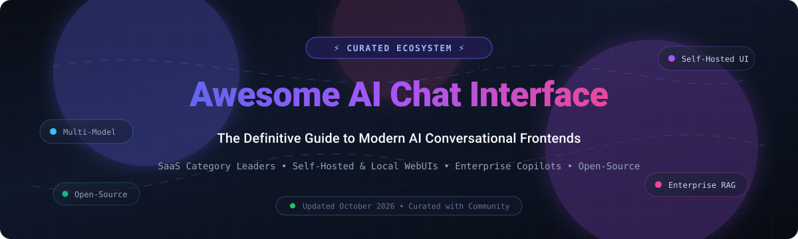
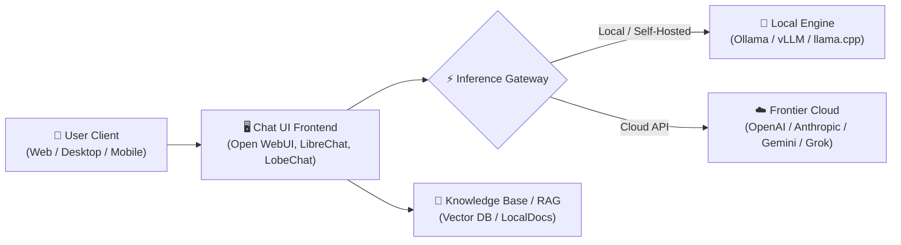

# ⚡ Awesome AI Chat Interface

  

  
  
  
  
  
  

---

## 🌟 Overview & Highlights

A curated directory and ultimate landscape of **AI Chat Interfaces**, **Multi-Model Web Frontends**, **Self-Hosted LLM Workspaces**, and **Enterprise Conversational Copilots**.

Whether you are looking for enterprise SaaS platforms (ChatGPT, Claude, Gemini) with frontier multimodal models, or self-hosted open-source interfaces (Open WebUI, NextChat, LobeChat, LibreChat) connected to Ollama, vLLM, and Hugging Face, this repository organizes the complete conversational AI frontend ecosystem.

> **Last updated:** October 2026 🗓️  
> **Key Topics:** `ai-chat`, `chat-ui`, `llm`, `generative-ai`, `rag`, `multi-model`, `self-hosted`, `ollama`

---

## 📑 Table of Contents

- [📊 Sector Overview & Market Dynamics](#-sector-overview--market-dynamics)
- [🏢 SaaS & Hosted Platforms](#-saas--hosted-platforms)
- [💻 Open-Source GitHub Projects](#-open-source-github-projects)
- [🛠️ Deployment & Architectural Frameworks](#️-deployment--architectural-frameworks)
- [🤝 How to Contribute](#-how-to-contribute)
- [⭐ Star History](#-star-history)
- [💖 Support & Sponsor](#-support--sponsor)
- [📜 Disclaimer](#-disclaimer)

---

## 📊 Sector Overview & Market Dynamics

The global conversational AI and AI chat interface market is estimated to reach **$45–50 billion by 2028–2030**, compounding at an aggressive ~24–30% CAGR as enterprises rapidly transition from basic search to generative copilots. 

The sector exhibits **moderate concentration with a distinct dual-tier structure**: while foundational consumer attention leans toward a consolidated set of hyperscale winners (OpenAI, Microsoft, Google, Anthropic), the application and frontend orchestration layers remain **highly active and fragmented**, driven by self-hosted open-source frontends (Open WebUI, LibreChat, LobeChat), local privacy-first offline runtimes, and niche multi-model aggregator interfaces.

---

## 🏢 SaaS & Hosted Platforms

The primary enterprise and consumer cloud platforms providing fully managed AI chat interfaces:

| Platform | Company & Size (Valuation / Market Cap / Revenue) | Pricing (Starting Paid Tier) | Free Tier Limits | Description |
| :--- | :--- | :--- | :--- | :--- |
| **[Microsoft Copilot Pro / Copilot Studio](https://copilot.microsoft.com/)** | **Microsoft** Market Cap: ~$3.1T (FY25 Revenue: $245B+) | $20/user/month (Copilot Pro) / $30/user/month (Copilot for M365) | Free forever with Microsoft account: Standard access to GPT-4o, web grounding, 15 daily boosts for image generation (Designer). | Microsoft's conversational AI assistant embedded across Windows 11, Edge browser, and Microsoft 365 apps. |
| **[Google Gemini Advanced](https://gemini.google.com/)** | **Alphabet (Google)** Market Cap: ~$2.1T (FY24 Revenue: $350B+) | $19.99/month (Google One AI Premium plan) | Free forever plan: Standard access to Gemini 1.5 Flash / Pro with rate limits, standard image generation, and 15 GB unified Google storage. (Paid tier includes 1-month free trial). | Multimodal chat interface tightly integrated with Google Workspace, search groundings, and Google Drive. |
| **[ChatGPT Enterprise](https://openai.com/enterprise)** | **OpenAI** Valuation: ~$157B (Annualized Revenue: $3.7B+) | $20/user/month (Team tier, billed annually) or $25/user/month (monthly); Enterprise starting at ~$60/seat/mo | Free forever plan: Standard GPT-4o mini unlimited access, dynamic rate-limited access to GPT-4o (typically ~10–16 messages every 3 hours before falling back), and up to 2 image generations/day. | OpenAI's flagship conversational interface offering frontier models, custom GPTs, Canvas, and workspace management. |
| **[Grok (xAI)](https://x.ai/)** | **xAI** Valuation: ~$50B | $8/month (X Premium) or $16/month (X Premium+) | Free tier available to X users with verified phone: Limited to 10 queries every 2 hours on Grok-2 and up to 2 image generation requests per day. | xAI's real-time chat and reasoning model featuring live X (Twitter) platform integration and multimodal capabilities. |
| **[Claude Pro / Claude Team](https://claude.ai/)** | **Anthropic** Valuation: ~$40B (Annualized Revenue: ~$1B) | $20/month (Claude Pro) or $25/user/month (Claude Team, min 5 seats) | Free forever plan: Dynamic message limit based on demand (~10–30 messages every 5 hours on Claude 3.5 Sonnet) with 5 file attachments per conversation (up to 10MB each). | Anthropic's chat workspace optimized for coding, long-context reasoning (200k tokens), and Artifacts. |
| **[Perplexity Enterprise](https://www.perplexity.ai/)** | **Perplexity AI** Valuation: ~$9B | $20/month (Perplexity Pro) or $40/seat/month (Enterprise Pro) | Free forever plan: Unlimited standard quick searches, up to 5 Pro Searches every 4 hours, and up to 3 file analysis uploads daily. | Search-augmented conversational AI engine providing web citations, document synthesis, and model switching. |
| **[HuggingChat](https://huggingface.co/chat)** | **Hugging Face** Valuation: ~$4.5B | $9/month (Hugging Face PRO, includes $2/mo inference credits) | Free forever plan: Access to open-weight models (Llama, Mistral, Qwen) with a monthly credit pool (~$0.10/mo equivalent) subject to burst rate-limiting. | Open-source community chat frontend supporting open-weight models, community assistants, and web search plugins. |
| **[You.com Pro](https://you.com/)** | **You.com** Valuation: ~$1.5B (Total Funding: ~$195M) | $20/month (You.com Pro) | Free forever plan: Limited basic web search queries, up to 5 file uploads per query (max 5MB file size), and 1 workspace collaborator. | AI search and chat assistant combining real-time web citations, multi-model switching, and document analysis. |
| **[Pi.ai](https://pi.ai/)** | **Inflection AI** Valuation: ~$1.2B (Peak $4B, restructured after $650M MSFT licensing) | Free / Developer API pay-as-you-go | Free forever: 100% free consumer chat and voice interaction with no paid subscription paywall or message gating on pi.ai and mobile apps. | Emotionally intelligent conversational companion designed for natural voice dialogues, brainstorming, and personal support. |
| **[Poe](https://poe.com/)** | **Quora** Valuation: ~$500M | $19.99/month or $199.99/year (Includes 1,000,000 monthly compute points) | Free forever plan: Daily allowance of 3,000 compute points for standard bots (e.g. Claude 3 Haiku, GPT-4o-mini), resetting every 24 hours. | Multi-bot chat aggregator by Quora unifying frontier models, user-created bots, and custom prompt bots in one interface. |

---

## 💻 Open-Source GitHub Projects

Self-hosted, extensible, and community-driven frontends sorted by GitHub Stars_Count (descending) 🌟:

- **[Open WebUI](https://github.com/open-webui/open-webui)**   
  🚀 Feature-rich, user-friendly self-hosted web UI designed for Ollama and OpenAI-compatible backends. Supports built-in RAG, web browsing, multi-user role-based management, and agentic workflows.

- **[NextChat](https://github.com/ChatGPTNextWeb/NextChat)**   
  ⚡ Lightweight, cross-platform ChatGPT/Claude/Gemini web and desktop UI with client-side encryption, custom domain proxying, and one-click deployment on Vercel.

- **[LobeChat](https://github.com/lobehub/lobe-chat)**   
  🎨 Modern-design AI chat framework offering multi-model support, plugin marketplace, multimodal TTS/STT, knowledge bases, and custom agent personality personas.

- **[GPT4All](https://github.com/nomic-ai/gpt4all)**   
  🔒 Free-to-use, locally running, privacy-aware chatbot and desktop GUI ecosystem powered by Nomic AI with LocalDocs document chat capabilities.

- **[AnythingLLM](https://github.com/Mintplex-Labs/anything-llm)**   
  📚 All-in-one desktop and enterprise-grade web chat application supporting full document RAG, custom AI agents, multi-tenant authentication, and flexible model routing.

- **[text-generation-webui](https://github.com/oobabooga/text-generation-webui)**   
  🧪 The definitive Gradio-based interface for running open-weights LLMs locally with extensive backend support (Transformers, llama.cpp, ExLlamaV2, AutoGPTQ).

- **[LibreChat](https://github.com/danny-avila/LibreChat)**   
  🛠️ Comprehensive open-source ChatGPT clone supporting multiple AI providers (OpenAI, Anthropic, Gemini, Ollama), Code Interpreter, multi-user presets, and DALL-E integration.

- **[Jan](https://github.com/janhq/jan)**   
  💻 Privacy-first, open-source 100% offline desktop alternative to ChatGPT that runs on consumer hardware with local hardware acceleration (NVIDIA, Apple Silicon, Vulkan).

- **[SillyTavern](https://github.com/SillyTavern/SillyTavern)**   
  🎭 Highly customizable frontend specialized for creative writing, power users, character roleplaying, lorebooks, and multiple API/local LLM connectors.

- **[Chatbot UI](https://github.com/mckaywrigley/chatbot-ui)**   
  📐 Clean, minimalist open-source ChatGPT interface built with Next.js, TypeScript, and Supabase for customizable personal or team use.

- **[HuggingChat UI (chat-ui)](https://github.com/huggingface/chat-ui)**   
  🤗 Official open-source SvelteKit frontend powering Hugging Face's public HuggingChat service; ready for private Docker and Hugging Face Space deployments.

- **[Big-AGI](https://github.com/enricoros/big-AGI)**   
  🧠 Generative AI suite and high-performance chat interface with multi-model comparison, persona engineering, code execution, and multi-chat workflows.

- **[BionicGPT](https://github.com/bionic-gpt/bionic-gpt)**   
  🏢 Open-source, on-premise ChatGPT replacement for enterprises focused on strict data privacy, role-based access control (RBAC), and enterprise SSO integration.

---

## 🛠️ Deployment & Architectural Frameworks

Building and deploying your custom conversational AI stack typically involves pairing a user-facing frontend with a compute backend:

- **Frontend Deployment**: Stand up frontends like **Open WebUI**, **LibreChat**, or **LobeChat** using Docker containers or Kubernetes.
- **Model Endpoints**: Bridge through OpenAI-compatible REST endpoints, direct Ollama instances, or enterprise gateway proxies (LiteLLM).
- **Security & RAG**: Enable multi-user authentication (OIDC, SSO), session encryption, and semantic search over internal documentation.

---

## 🤝 How to Contribute

Contributions are warmly encouraged! 🎉

1. 🍴 Fork the repository.
2. 🌿 Create a new feature branch (`git checkout -b feature/new-chat-ui`).
3. ✏️ Add or update entries following the established table or badge format.
4. 📝 Ensure official links, neutral descriptions, and accurate metadata.
5. 🚀 Submit a Pull Request with a clear explanation of your additions.

---

## ⭐ Star History

---

## 💖 Support & Sponsor

Thank you for exploring and using **Awesome AI Chat Interface**! If this curated collection helps your work, research, or self-hosting journey, please consider supporting the project:

- ⭐ **Star** this repository on GitHub to help others discover it.
- 🍴 **Fork** and contribute new tools or updates.
- 📢 **Share** with your friends, colleagues, and AI developer communities.
- ☕ **Buy a coffee & sponsor**: If you'd like to support ongoing maintenance and new open-source initiatives, visit the **[GitHub Sponsor Dashboard](https://github.com/sponsors/ishandutta2007)**.

Your support and contributions keep this directory fresh, accurate, and independent! 🚀

---

## 📜 Disclaimer

- This is an open **community-curated** resource and does not constitute an official endorsement of any listed service or software.
- AI chat interfaces process natural language prompts and sensitive message logs. Ensure self-hosted instances adhere to local security, compliance, and privacy policies.

---

  <b>Curated with ❤️ by <a href="https://github.com/ishandutta2007">Ishan Dutta</a> and the Open Source Community.</b>

